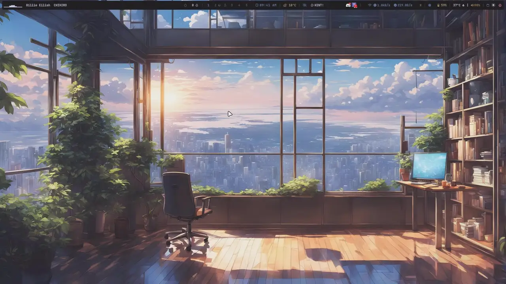
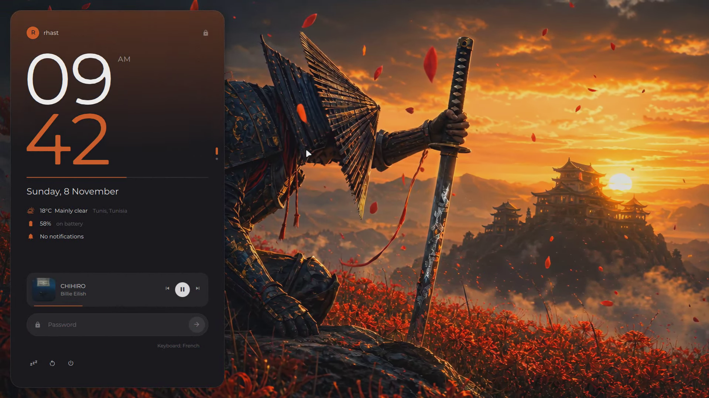
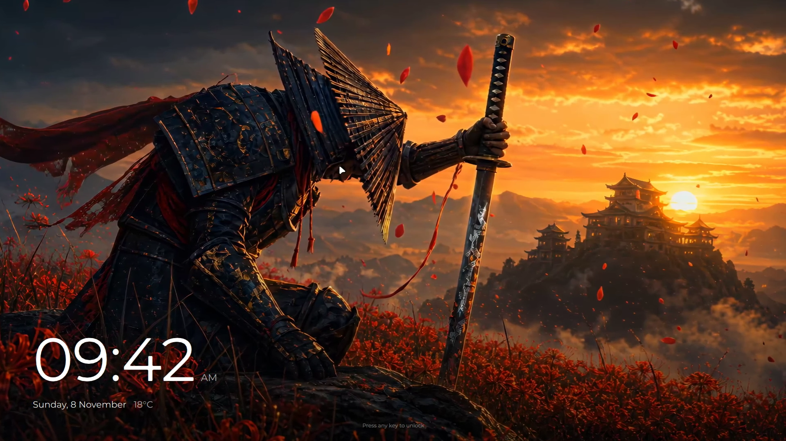
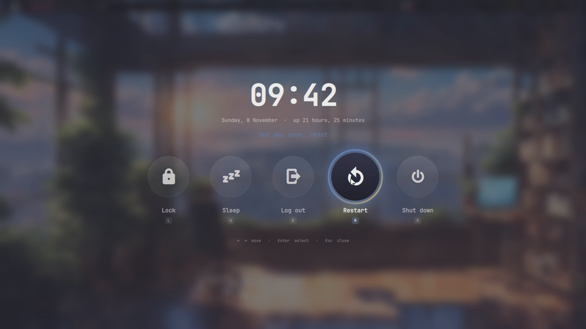
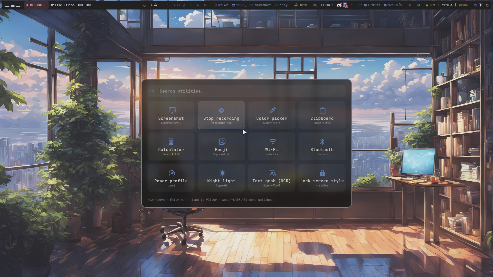
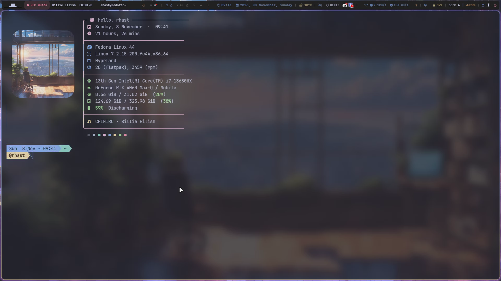
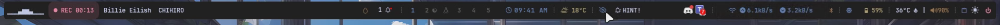

Both `./setup` (graphical) and `./install.sh` (terminal) use the same installation
backend for graphics detection, driver setup, Secure Boot checks, session setup,
and the wallpaper waiting screen. Existing configuration is backed up first.
See the [desktop guides](docs/README.md) and the [test suite](docs/TESTING.md).

<h1 align="center">Hyprland Desktop</h1>

<p align="center">
  <b>A polished Hyprland desktop for Arch, Fedora and Ubuntu</b><br>
  Catppuccin Mocha · wallust adaptive accents · Quickshell lock screen · Waybar · rofi
</p>

<p align="center">
  
</p>

## Demo

<p align="center">
  
</p>

<p align="center"><i>App launcher, terminal, power menu, utilities hub, lock screen, and a wallpaper switch where every colour follows the new wallpaper (1.5× speed).<br>
Full-quality recording: <a href="assets/demo.mp4">demo.mp4</a></i></p>

## Screenshots

### Lock screen


### Lock screen: ambient mode


### Power menu


### Utilities hub (Super+X)


### Terminal


### Waybar


## Features

- **Lock screen** — 4 switchable styles (Slate, Iris, Fog, Cards). Frosted wallpaper, music controls with album art and cava visualizer, weather, battery, ambient mode. Secure Wayland session lock with hyprlock fallback.
- **Power menu** — animated orbs with a 3-second countdown ring. Lock, sleep, logout, restart, shutdown.
- **Volume & brightness OSD** — glass pill overlay with accent-colored progress bar, follows your wallpaper theme.
- **Waybar** — adaptive colors from wallpaper. Wi-Fi with speed, Bluetooth with battery, GPU/CPU, privacy indicators, cava visualizer. Left-click Bluetooth for Blueman and right-click for the quick Bluetooth menu.
- **Utilities hub** (Super+X) — screenshot, screen recorder, color picker, clipboard, calculator, emoji, Wi-Fi, Bluetooth, power profiles, night light, OCR, lock screen style switcher.
- **Keyboard Shortcuts GUI** — add and edit shortcuts without config files.
- **Video wallpapers** — Super+W picks images or videos; mpvpaper with hardware decoding, pauses under fullscreen, restores on reboot.
- **Spotify integration** — runs in the background, toggle with Super+Alt+M, Super+Q hides instead of closing.
- **Adaptive theming** — wallust extracts colors from wallpaper; AccentGuard ensures WCAG-readable accents across Waybar, GTK, kitty, and the lock screen.
- **Appearance Manager** (Super+Ctrl+Alt+T) — choose a desktop look, Waybar style or layout, animations, Rofi, blur, or rendering profile from one menu. **Super+Ctrl+T** opens the desktop theme picker. The five looks are Ultimate, end-4 Material, ML4W Soft, Omarchy Sharp, and Rhast. Waybar and animations can follow the desktop theme or keep an explicit selection.
- **Theme rendering** — Ultimate and end-4 Material use stronger blur and shadows. Omarchy Sharp disables both in its preset. The existing Performance Mode applies after the theme and Liquid Glass settings.
- **Window tools from Omarchy** — pop a window out and pin it (Super+O), zen mode (Super+Shift+Backspace), per-window transparency (Super+Backspace), idle-lock toggle (Super+Ctrl+I), power menu (Super+Escape).
- **Smarter window rules from end-4** — file pickers and "wants to save/open" dialogs float centred, every Picture-in-Picture spelling is pinned, screen-sharing bars stay small, games get the lowest-latency (tearing) path.
- **All 53 Waybar styles checked** — broken colours fixed; see-through styles get a light tint so the blur makes them frosted glass instead of unreadable.
- **Hyprland 0.57 Lua** — full compatibility layer that loads `.conf` files through the new Lua config, with auto-reload.

## GPU Support

Automatic detection and configuration for:
- **NVIDIA** — open kernel modules (Fedora: akmod + Secure Boot MOK signing; Arch: nvidia-open; Ubuntu: ubuntu-drivers), PRIME offload for hybrid laptops, VA-API, suspend/resume
- **AMD** — Mesa with full video decoding (Fedora: freeworld), PRIME offload for hybrid setups, VA-API with radeonsi
- **Intel** — iHD media driver, hybrid GPU pairing

On Fedora, the fixed installer keeps its more conservative driver selection.

PCI detection works even before a graphics driver loads. The connected display
sets runtime GPU preference, while explicit user overrides and additional GPUs
remain available. Mixed AMD/NVIDIA systems use vendor auto-detection instead of
forcing NVIDIA libraries globally.

- **NVIDIA:** preserves a loaded stack; validates new drivers against NVIDIA's
  support table, signs akmods when Secure Boot is enabled and guides MOK enrollment.
  Unknown/unsupported branches stop clearly instead of installing a guessed driver.
- **AMD:** retains the kernel amdgpu driver and Mesa graphics stack.
- **Intel:** installs media drivers and lets libva select the implementation.

The bar reports NVIDIA usage through nvidia-smi and AMD usage through amdgpu sysfs. On Intel, it shows a utilization counter when available or labels the measured GPU clock in the tooltip.

Run `~/.config/hypr/scripts/GpuInfo.sh` to see your detected setup.

## Install

### Graphical Installer (recommended)

```sh
cd /path/to/this/hyprland-dotfiles-fixed
./setup
```

A GTK4 installer walks you through package installation, driver setup, and configuration.

### CLI

```sh
./install.sh                 # everything: Hyprland, drivers, apps, configs
./install.sh --no-base       # Hyprland already installed: configs + apps only
./install.sh --sddm          # also the themed SDDM login screen
./install.sh --jack-fix      # 3.5mm jack silent? keep it on despite broken jack detection
./install.sh --help          # all options (bar style, lock style, keyboard, no drivers)
```

### Supported systems

| Distro | Hyprland from | Notes |
|---|---|---|
| **Arch** (and Arch-based) | official repos | wallust, wlogout, mpvpaper, cursor/GTK theme from the AUR (yay is installed if missing) |
| **Fedora** | sdegler COPR via JaKooLit's Fedora-Hyprland scripts | RPM Fusion for drivers and codecs |
| **Ubuntu 26.04 LTS or newer** | `ppa:cppiber/hyprland` | wallust, awww and mpvpaper are built from source; Quickshell too on 26.04 (packaged from 26.10). Ubuntu 24.04/25.10 can't run this desktop (X11-only rofi, Qt too old for Quickshell) |

**Requirements:** `git` and an internet connection. The installer handles everything else — Hyprland, packages, GPU drivers, configs, and theming.

Both installers set up drivers by default. `./install.sh --no-drivers` preserves
existing drivers; `--no-base` skips the base packages while still doing driver and
configuration setup. `--base` explicitly reinstalls the base. Existing GPU stacks
are preserved. Firmware MOK approval requires the user's physical action at reboot;
it is never bypassed and Secure Boot is never disabled.

The packaged Hyprland session remains available alongside **Hyprland (Desktop
dotfiles)**. The installer preselects the latter for GDM/SDDM. Monitor mode matching
and the experimental Aquamarine patch are separate optional tools.

Existing configs are backed up to `~/.config-backup-<date>/` before replacement.

## Keyboard Shortcuts

| Keys | Action |
|---|---|
| Super+Enter | terminal (kitty) |
| Super+L | lock |
| Super+X | utilities hub |
| Super+H | cheat sheet |
| Super+Q | close window (hides Spotify) |
| Super+W | wallpaper picker |
| Super+Alt+M | toggle Spotify |
| Super+Alt+Print | start/stop screen recording |
| Super+Alt+X | color picker |
| Super+Alt+T | text grab (OCR) |
| Super+Ctrl+Alt+T | appearance manager |
| Super+Ctrl+T | desktop theme |
| Super+Ctrl+B | Waybar style |
| Super+Alt+B | Waybar layout |
| Super+Shift+A | animations |
| Super+Shift+T | next theme |
| Super+O | pop window out (float + pin) |
| Super+Shift+Backspace | zen mode |
| Super+Escape | power menu |

## Credits

Built on top of [JaKooLit's Hyprland dotfiles](https://github.com/JaKooLit/Hyprland-Dots) and [Fedora-Hyprland](https://github.com/JaKooLit/Fedora-Hyprland), with looks, animations, rules and keybinds adapted from [end-4](https://github.com/end-4/dots-hyprland), [Omarchy](https://github.com/basecamp/omarchy), [ML4W](https://github.com/mylinuxforwork/dotfiles) and [HyDE](https://github.com/HyDE-Project/HyDE), plus [Catppuccin Mocha](https://github.com/catppuccin/catppuccin) theming and [wallust](https://codeberg.org/explosion-mental/wallust) color extraction.
